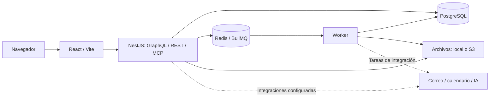

# Arquitectura observada

Referencia: Twenty `twenty/v2.51.0`, `15e4826d3b5fc5867baeabeeb42b253892b2d4da`. Inspección estática del 27 de octubre de 2026.

Es un mapa lógico del código, no servicios activos en esta máquina. Las flechas externas dependen de configuración y autorización.

## Componentes

| Componente | Evidencia y función |
| --- | --- |
| Monorepo TypeScript | `package.json`, `nx.json`, `yarn.lock`; Nx 22.7.12, Yarn 4.18.1, Node declarado `^24.5.0` |
| Frontend | `packages/twenty-front`; React `^19.2.0` en manifiesto, Vite, Jotai, Linaria, Lingui y Apollo. La orientación upstream todavía menciona React 18: prevalece el manifiesto |
| Backend | `packages/twenty-server`; NestJS 11, TypeORM, GraphQL, REST y MCP |
| Procesamiento asíncrono | `src/queue-worker/queue-worker.ts`, BullMQ 5.78.0 y Redis; worker separado del servidor |
| Datos | PostgreSQL; Compose principal/dev usa 16. El Dockerfile de la imagen auxiliar de análisis usa 18: no confundir esos entornos |
| Migraciones | `src/database/commands/upgrade-version-command/`, comandos de instancia y migraciones de metadata por workspace; `database:migrate:prod` ejecuta `run-instance-commands` |
| Archivos | Driver local y S3; volumen compartido entre servidor y worker en Compose |
| Tipos y bibliotecas | `twenty-shared`, `twenty-ui`, `twenty-emails`, `twenty-client-sdk` |
| Aplicaciones | `twenty-sdk`, `twenty-cli`, `create-twenty-app`, `twenty-front-component-renderer` y `twenty-apps`; manifiestos, funciones y componentes de interfaz |
| Automatización e IA | `src/modules/workflow`, `src/engine/metadata-modules/ai`; workflows, herramientas, agentes, proveedores de modelos y conexiones MCP |
| Observabilidad | Consola, Sentry opcional, métricas OpenTelemetry/Prometheus opcionales; ClickHouse para analítica configurada |

## Fronteras de confianza

El modelo separa tablas globales en `core` y esquemas de datos por workspace. Esto proporciona una frontera lógica, no una prueba de aislamiento completo ni separación física de tenants. La autorización de registros se concentra en `src/engine/twenty-orm/`, el contexto de autenticación y los data sources de workspace. GraphQL, REST, MCP y herramientas de IA dependen de esa capa.

Los principales incluyen usuarios, API keys, aplicaciones y contexto de sistema. `AuthPrincipalGuard` limita tipos de principal; los permisos de configuración usan guards específicos. `NoPermissionGuard` y `PublicEndpointGuard` no demuestran por sí solos un fallo: hay rutas públicas con autenticidad validada en el handler. Las rutas que usan contexto de sistema o bypass de permisos merecen pruebas específicas.

Las sesiones usan cookies HTTP-only y protección de origen; API keys y OAuth tienen sus propios flujos. En `user-session-cookie.service.ts`, `secure` depende del tipo de despliegue y `sameSite` de configuración (predeterminado `lax`). En localhost HTTP, esa cookie no puede tener las mismas propiedades de transporte que en producción HTTPS.

Las funciones `LOCAL` son procesos del host, no sandboxes. El intérprete Python local tampoco está aislado. Los drivers Lambda y E2B son alternativas existentes, pero no se han configurado ni autorizado servicios externos para ellos. El bootstrap debe comenzar con ambos tipos de ejecución desactivados.

## Interfaces

- GraphQL de registros: `/graphql`; metadata: `/metadata`.
- REST: `/rest` y `/rest/metadata`.
- MCP: `/mcp`, controlador `engine/api/mcp/controllers/mcp-core.controller.ts`; JSON-RPC y SSE según `Accept`, con `McpAuthGuard`, validación de DTO y contexto de workspace.
- Health: `/healthz`. Configuración del frontend: `/client-config`.
- OAuth de aplicaciones, webhooks, archivos y rutas de funciones forman superficies adicionales; cada una necesita su propia comprobación.

## Construcción y arranque declarados, no ejecutados

El desarrollo oficial usa Linux/macOS o WSL en Windows. Los targets declaran `nx build twenty-shared`, `nx build twenty-server`, `nx build twenty-front`, `nx start twenty-server`, `nx worker twenty-server` y `nx start twenty-front`. El frontend usa 3001 y el servidor 3000 en los ejemplos; AOS debe elegir puertos propios después de comprobar ocupación.

`packages/twenty-docker/twenty/Dockerfile` permite construir desde este código y sirve el frontend compilado desde el backend. Su imagen base está fijada por digest; el Compose distribuido usa por defecto una imagen publicada con tag móvil. El bootstrap de AOS debe construir y nombrar su propia imagen con SHA, sin depender de `latest`.

No se ejecutó `setup-dev-env.sh`: puede cambiar la contraseña del PostgreSQL local y su modo reset elimina bases genéricas y vacía Redis. Eso colisiona con el requisito de no alterar otros productos.

El grafo AOS se construyó sobre este checkout: 34.624 archivos indexados, 343.598 nodos y 901.447 aristas. El primer intento agotó los diez minutos del CLI; el reintento con el mismo módulo AOS y plazo de treinta minutos terminó con código 0. `aos graph status` confirma índice actualizado, y la consulta de `TelemetryService` devuelve el archivo de este repo. Resultado y consulta de identidad están en las evidencias locales. Un grafo completo para el motor no implica que resuelva todas las llamadas posibles ni acredita build o arranque de la aplicación.
